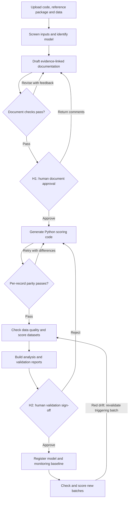

# Model Risk Factory

An agent-assisted workflow for documenting, rebuilding, validating, and monitoring legacy financial models. Built by Team A for **EXL x UCD Data & AI Hackathon 2026, Challenge 04: Agentic model risk factory**.

Upload a SAS, R, or Python model and its supporting data. The factory creates an inventory record, drafts an evidence-linked document, checks its quality, rebuilds supported SAS/R scoring logic in Python, compares individual predictions against reference scores, generates validation reports, and monitors new batches. People make the documentation and validation approval decisions.

## The problem and intended benefit

Banks maintain models in different languages, often with incomplete documentation. Understanding a model, checking a migration, assembling validation evidence, and following up on changes can require repeated manual work across teams.

Model Risk Factory connects these tasks in one recorded workflow. Its intended benefit is less repeated preparation and handover work, consistent checks, and easier access to evidence. **Measured time savings and ROI are not yet available:** the manual baseline has not been recorded. The challenge's indicative bank portfolio and validation times are problem context, not measured prototype results.

## Challenge coverage

| Requirement | Implementation | Evidence and boundary |
| --- | --- | --- |
| Document 3-5 models and build inventory records | Four core examples, M001-M004; classification, inventory, cited documentation, document rating | M003 currently covers inventory/documentation; its trained scoring artifact and required data are not supplied |
| Rebuild a SAS/R model in Python with parity proof | Rebuild agent, restricted scoring execution, per-record comparison, downloadable code and certificate | M001/M002/M004 have local verification; references are Python reproductions, not independent SAS/R exports |
| Generate performance, stability, and fairness reports | Metrics library, analysis/validation reports, numeric source ledger and rendered-number checks | Suitable labels, reference populations, and segment columns are required; missing evidence remains unassessed |
| Monitor drift and trigger revalidation | Quality checks, PSI/CSI, Gini change, alerts, periodic reports, return to H2 | Monitoring uses registered batches and does not automatically retrain models |

[Completion status](docs/completion-status.md) separates implementation, local verification, historical cloud evidence, and outstanding acceptance. [Rebuild verification](docs/submission/rebuild-verification.json) explicitly records its mock LLM and simulated approvals.

## End-to-end workflow



| Step | What it does | Result or next action |
| --- | --- | --- |
| Receive and screen | Check file/archive limits, selected personal-data patterns, and prompt-injection patterns | Model/pipeline IDs; invalid input rejected |
| Identify | Combine static parsing and LLM extraction for language, algorithm, purpose, variables, target | Classification, evidence, confidence; uncertain cases go to manual review |
| Document | Use code, profiles, templates, and knowledge excerpts to explain the model and limits | Versioned Markdown document and evidence references |
| Rate | Rule checks worth 60 points plus a separate LLM review worth 40 | Score, vetoes, edit requests; up to three drafting attempts |
| H1 approval | A person reviews documentation | Recorded approval, or comments for another draft |
| Rebuild | Translate supported SAS/R scoring logic; parameter transcription is a fallback | Candidate Python code; existing Python source can skip translation |
| Prove parity | Run code and compare every reference record | Parity result and code-hash-bound certificate on success; up to five attempts |
| Score and measure | Check dataset quality, execute proven code, calculate applicable metrics | Saved predictions and metrics; invalid data refused |
| Report | Assemble analysis/validation views and recheck displayed numbers | HTML reports, findings, warnings, recommendations |
| H2 sign-off | A person reviews validation evidence | Recorded decision; approval registers lifecycle state and monitoring |
| Monitor | Compare new batches with the saved baseline | Metrics, alerts, reports; red drift returns the triggering batch to validation/H2 |

Retries are bounded. Uncertain identification, exhausted retries, and recoverable workflow errors enter the manual queue. Unexpected failures retain error/audit records. H1/H2 pause and resume through recorded decisions and checkpoints.

**The `deployed` state is internal lifecycle registration.** It does not deploy a model into a bank's lending system. Approval of drift revalidation preserves the original healthy baseline; a shifted population is not silently accepted as the new baseline.

## Three different assessments

| Assessment | Meaning | Distinction |
| --- | --- | --- |
| Document score, 0-100 | Completeness, evidence, variable consistency, methodology, limitations, clarity | A good document can describe a poor model |
| Validation traffic lights | Consistency, predictive performance, stability, fairness | Matching references does not establish model quality |
| Monitoring traffic lights | New-batch quality, distribution drift, available performance change | Red data quality differs from red model drift |

Binary credit-risk metrics include AUC, Gini, KS, Brier, Hosmer-Lemeshow calibration, PSI/CSI, and group outcome measures. Regression scoring records RMSE, MAE, and R-squared. The report performance light currently centers on Gini; a broader regression-specific validation view is future work.

Thresholds are project policy in [config/pipeline.yaml](config/pipeline.yaml), not automatic regulatory approval: confidence 0.7; document pass score 80 with no veto; all reference records within absolute tolerance `1e-6`; PSI/CSI amber from 0.10 through 0.25, red above 0.25 or Gini drop greater than 0.05.

## Examples and required inputs

| Model | Source | Purpose | Supported example |
| --- | --- | --- | --- |
| M001 | SAS logistic scorecard | Loan default probability | Documentation, rebuild, parity, scoring, monitoring |
| M002 | R binomial GLM | Credit-card default | Documentation, rebuild, parity, scoring |
| M003 | Python XGBoost training code | Behavioural scoring | Inventory/documentation; trained model/data still required |
| M004 | SAS linear regression | Synthetic pricing | Documentation, rebuild, parity, regression scoring |

See [legacy examples](models/legacy/README.md) and [six synthetic R/SAS examples](models/synthetic_validation/README.md). The latter provide controlled green/amber/red performance cases, not evidence of real customer generalization.

A reference package contains:

```text
model.sas / model.R     Source calculation
manifest.json           Record ID, score column, scoring metadata
coefficients.json       Fitted parameter estimates
input_sample.csv        Inputs for parity comparison
legacy_scores.csv       Reference score for each input record
```

Upload these files together, plus cleaned development/validation datasets when available. M001/M002/M004 can use built-in demo fixtures when matched by name. A raw training table alone cannot prove parity. This is not a universal SAS/R compiler.

## Local setup

Requirements: Python 3.11-3.13 and [uv](https://docs.astral.sh/uv/).

```bash
uv sync --extra data --extra ui --frozen
```

Copy `.env.example` to `.env` using your shell:

```powershell
# PowerShell
Copy-Item .env.example .env
```

```bash
# Bash
cp .env.example .env
```

Default `MRF_LLM_PROVIDER=mock` needs no model-service key. Set a local `MRF_API_KEY` in `.env`. Start the API and UI in separate terminals:

```bash
uv run uvicorn mrf.api.app:app --reload
```

```bash
uv run --extra ui streamlit run src/mrf/ui/app.py
```

- API reference: `http://localhost:8000/docs`
- Liveness: `http://localhost:8000/healthz`
- Readiness/runtime configuration: `http://localhost:8000/readyz`
- UI: `http://localhost:8501`

Sign in with the API key and operator name. The UI uses the local API by default; configure `API_BASE_URL` for another endpoint. Review decisions and alert handling record the operator.

An offline CLI check is also available:

```bash
uv run python -m mrf.run --model M001 --auto-approve
```

`--auto-approve` is local verification only, not independent human sign-off. Without dataset IDs, usability scoring is skipped. For validation, upload cleaned datasets through the UI/API and associate their IDs with the pipeline, or use the CLI's `--dataset` option.

For real calls, set `MRF_LLM_PROVIDER` to `azure_openai`, `openai`, or `github_models` and use the corresponding [.env.example](.env.example) settings. Report real-provider acceptance separately from mock tests.

## UI guide

| Page | Actions |
| --- | --- |
| Overview | See model/task/review/alert counts; upload code/data; start a pipeline |
| Pipelines | Follow progress, attempts, errors, usage, history, artifacts |
| Review queue | Review H1 documents, H2 reports, manual escalations; record decisions |
| Models | Browse classification, document versions, rebuilds, runs, reports; download code/certificates |
| Monitoring | Upload/process batches, inspect charts, acknowledge/close alerts, configure schedules, build reports |

A standalone rebuild does not approve H1/H2 or advance the original pipeline. Acknowledging records ownership; closing an alert requires a resolution and does not change metrics. See [rebuild troubleshooting](docs/rebuild-troubleshooting.md) and [monitoring](docs/monitoring.md).

## Architecture

- **FastAPI:** REST API, authentication, guards, request IDs, asynchronous job endpoints.
- **LangGraph:** state transitions, bounded retries, human interruptions, recovery, audit.
- **Agents:** classification, documentation, document review, rebuild candidates.
- **MCP tools:** parsing, profiling, inventory/knowledge retrieval, restricted execution, parity, metrics. Mounted at `/mcp`; in-process calls are the default.
- **Knowledge retrieval:** local TF-IDF with numpy and optional FAISS. Azure AI Search is not implemented.
- **Storage:** SQLite/local files by default; Cosmos DB/Azure Files in the cloud; Azure Blob is optional.
- **MLflow:** optional parameter/metric logging; scoring works without it.
- **Streamlit:** review and monitoring UI.

Read [architecture diagrams](docs/architecture.md), [runtime profiles](docs/runtime-profiles.md), [OpenAPI](openapi.yaml), and [A1 design](docs/design/A1_orchestrator_api_design.md).

```text
src/mrf/
  api/                 REST routes and shared API behavior
  orchestrator/        Workflow, retries, review gates, assembly
  agents/              Classification, documentation, rebuild
  data/                Readers, preprocessing helpers, schemas
  rating/              Rubric, deterministic checks, LLM review
  validation/          Model and population metrics
  reporting/           HTML reports and numeric source ledger
  monitoring/          Quality, drift, alerts, reports
  mcp_server/          Agent tool service and gateways
  llm/                 Provider clients, retries, usage
  storage/             Repository and file adapters
  ui/                  Streamlit interface
models/                Legacy and synthetic examples
tests/                 Unit/integration tests and reference fixtures
templates/             Documents, reports, certificates
kb/                    Team summaries, templates, mapping notes
infra/ docker/         Azure infrastructure and containers
docs/                  Design, handoffs, evaluation, submissions
```

## Azure and evaluation

Infrastructure defines dev/demo environments on Azure Container Apps in `swedencentral`, with API, UI, and hourly monitoring trigger. Azure access uses managed identity. The API uses a **single replica** because its queue is in-process.

| Environment | Delivery |
| --- | --- |
| dev | Successful main-branch CI triggers `cd-dev` |
| demo | Manually trigger `cd-demo` with the image validated in dev |

Infrastructure definitions and a historical working environment do not prove latest-version acceptance. Check `/readyz` and retain revision, provider/model, dataset IDs, and evaluation artifacts. Never commit or post credentials. See [infrastructure](infra/README.md).

Set the API key in `MRF_EVAL_API_KEY`, then evaluate a real-provider deployment:

```bash
uv run python scripts/evaluate.py --api <dev-api> --model M001 --dataset <development-id> --dataset <validation-id> --runs 5 --strict --require-real-llm --report-out var/eval/evaluation.md
```

The [checked-in evaluation](docs/evaluation.md) is mock and unsuitable for real LLM speed/cost or business claims. The [manual baseline](docs/submission/manual-baseline.md) is unmeasured.

## Responsible AI and limits

- Input screening detects selected identifiers/injection patterns, not every privacy or security risk.
- Documentation retains evidence; unsupported claims are filtered/checked. Reports validate numbers against recorded facts.
- H1/H2 record explicit decisions. Role names do not establish organizational independence or regulatory compliance.
- Generated code runs with policy checks, a subprocess, and time limits. Strong multi-tenant isolation remains production work.
- Independent SAS/R reference exports remain an acceptance requirement.
- Alerts appear in-app, in reports, and in logs; email/Teams/Slack delivery is not implemented.
- The knowledge base contains team summaries; complete official SS1/23 text ingestion and interpretation require separate review.

See [Responsible AI](docs/responsible_ai.md) and [completion status](docs/completion-status.md).

## Development checks and team

```bash
uv sync --all-extras --frozen
uv run ruff check .
uv run mypy
uv run pytest -q
uv run bandit -c pyproject.toml -r src -ll --skip B608
```

Tests use mock LLM/isolated storage by default. On restricted Windows environments, place temporary files under the workspace. Contribution/contract-review rules: [CONTRIBUTING.md](CONTRIBUTING.md).

| Member | Responsibility |
| --- | --- |
| A1 Albert | Orchestration, API, classification, shared runtime, integration |
| A2 | Legacy examples, data, rebuild, parity, scoring |
| A3 | Knowledge, documentation, rating, validation, reports, Responsible AI |
| A4 | CI/CD, Azure, monitoring, UI, presentation |

Further reading: [team interfaces](docs/team/README.md), [integration](docs/team/integration.md), [execution plan](docs/team-execution-plan.md), [submission materials](docs/submission/README.md).

AI coding assistance is declared in [docs/ai_tools_declaration.md](docs/ai_tools_declaration.md). Runtime AI safeguards and limits are described separately in the Responsible AI note.
