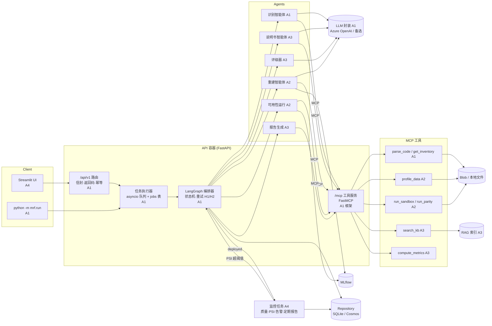
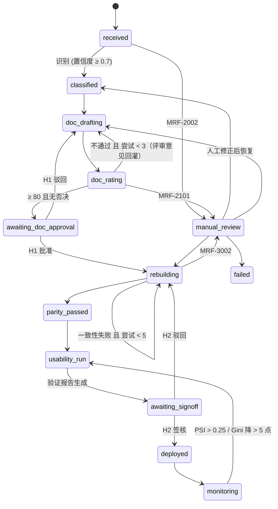

# 架构总览

> 1 页架构图（提交用 PNG/PDF）由 A1 在 11/12 根据本文导出；本文是可维护的源文件。

## 组件与数据流

## 流水线状态机

## 关键约定

| 主题 | 约定 | 位置 |
|---|---|---|
| 响应 | 统一信封，`status` ∈ success/accepted/error，`errors`/`warnings` 恒为数组 | `mrf.core.envelope` |
| 返回码 | MRF-0000 … MRF-5000 | `mrf.core.codes` |
| 状态 | 13 个状态 + 允许的迁移表 | `mrf.core.states` |
| 阈值 | 置信度 0.7、说明书 3 次、一致性 5 次、通过分 80、PSI 0.10/0.25 | `config/pipeline.yaml` |
| 模块接口 | Classifier / DocWriter / Rater / Rebuilder / ModelRunner / ReportBuilder / DataQualityChecker / MonitoringRegistrar | `mrf.contracts.agents` |
| 取数 | 智能体只通过 7 个 MCP 工具取数，不自己算数字 | `mrf.mcp_server.tools` |
| 两类重试 | 质量重试由编排器计数；LLM 瞬时错误在 `mrf.llm` 内按 1s/2s/4s+抖动 退让，不占质量重试次数 | A1 设计文档 |
