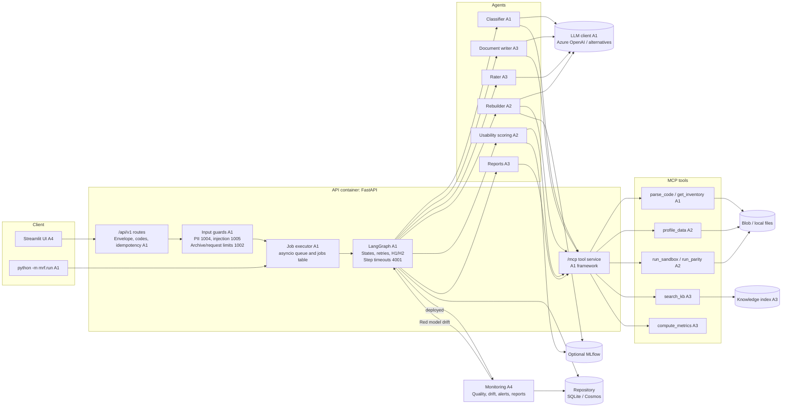
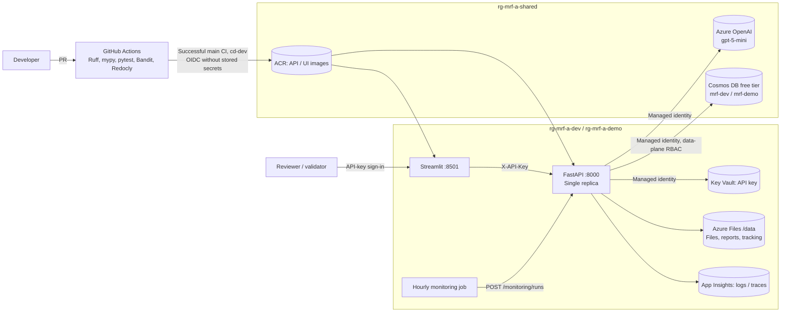
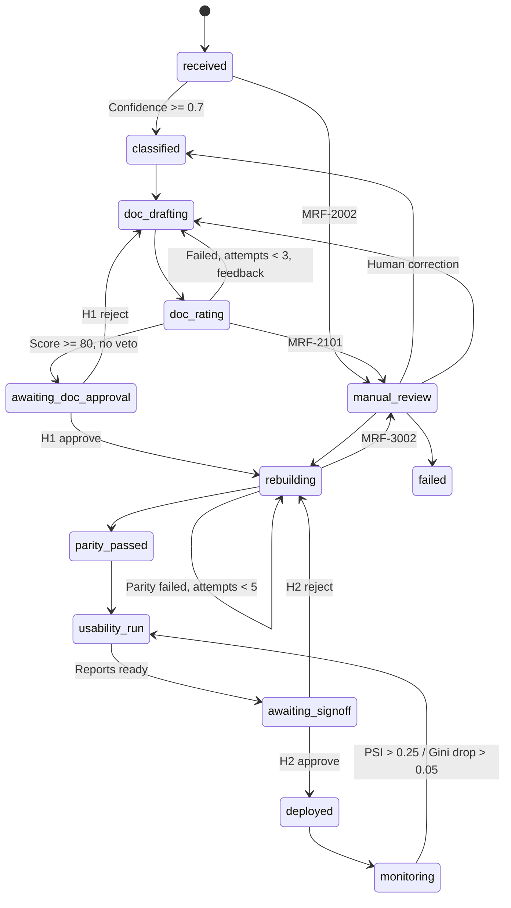

# Architecture overview

The one-page submission diagram is derived from this maintainable source. Historical delivery dates below are planning context; use completion status for current acceptance.

## Components and data flow

Uploaded code, archive text, form fields, and review comments are screened before inclusion in LLM prompts. Errors identify file/type/line without echoing the matched value (`mrf.core.guards`; `config/pipeline.yaml: guards`).

## Azure deployment: swedencentral, Azure for Students

- Azure access uses user-assigned managed identity (`AZURE_CLIENT_ID`); no cloud keys in code/images. The application API key is in Key Vault.
- API is single-replica because jobs are in-process. Pipelines awaiting H1/H2 recover from stored state after restart.
- `/readyz` exposes runtime environment, storage backend, LLM provider/model, and guard state for external verification.

## Implementation snapshot: November 12

Real implementations are assembled explicitly. Local opt-in test doubles are separate from the deployment path.

| Module | Implementation | Owner |
| --- | --- | --- |
| Classification, orchestration, API, MCP framework, guards, evaluation | Implemented | A1 |
| Documentation, rating, analysis/validation reports, metrics | Implemented; real-provider prompt calibration remains acceptance work | A3 |
| Quality, monitoring registration, drift batches, monitoring reports, UI, Azure | Implemented | A4 |
| profile_data, run_sandbox, run_parity | Implemented | A2 |
| Rebuild agent, model runner, dataset/rebuild/run APIs, M001-M004 packages, parity certificates | Implemented by A1 for A2; A2 review remains required | A2 / A1 |

Rebuilding initially uses the LLM for `rebuild.llm_attempts` attempts; later, or if it produces no usable code, fitted parameter estimates are deterministically transcribed. Both paths require per-record sandbox parity before a certificate is issued. Deployment and independent-reference acceptance remain separate.

## Pipeline states

## Shared conventions

| Topic | Convention | Location |
| --- | --- | --- |
| Responses | Envelope; status success/accepted/error; errors/warnings always arrays | mrf.core.envelope |
| Codes | MRF-0000 through MRF-5000 | mrf.core.codes |
| States | 13 states and allowed transitions | mrf.core.states |
| Thresholds | Confidence 0.7; document 3 attempts; parity 5; pass 80; PSI 0.10/0.25 | config/pipeline.yaml |
| Interfaces | Classifier / DocWriter / Rater / Rebuilder / ModelRunner / ReportBuilder / DataQualityChecker / MonitoringRegistrar | mrf.contracts.agents |
| Numeric facts | Seven MCP tools; no LLM-invented numeric facts | mrf.mcp_server.tools |
| Retries | Orchestrator quality counters; client transient backoff 1s/2s/4s + jitter | A1 design |
