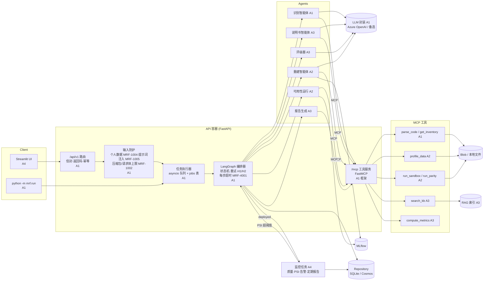
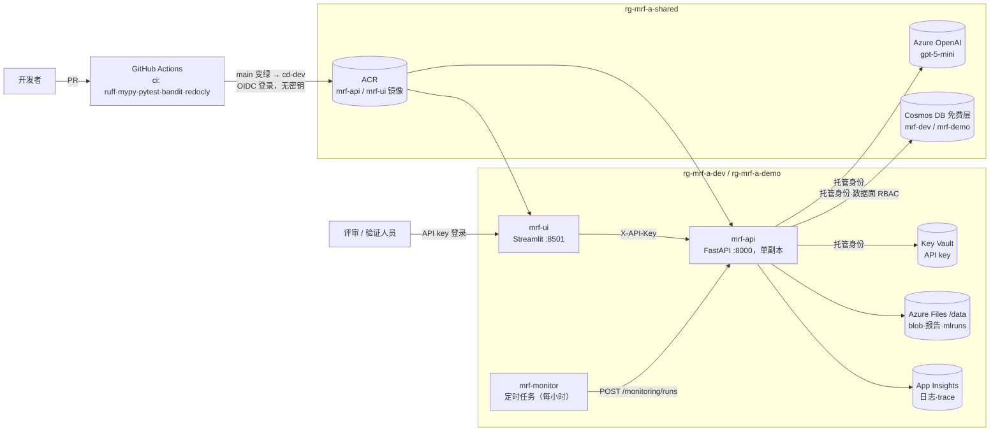
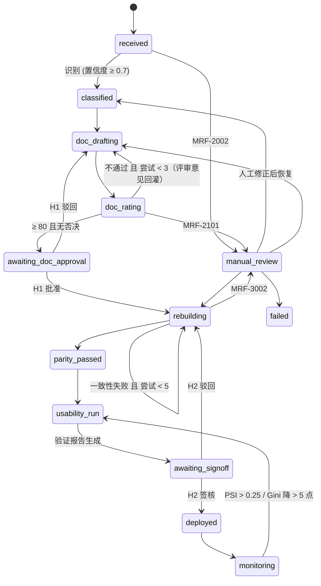

# 架构总览

> 1 页架构图（提交用 PNG/PDF）由 A1 在 11/12 根据本文导出；本文是可维护的源文件。

## 组件与数据流

上传的代码、压缩包内的文本文件、表单字段和审核意见，都要先经过输入防护，才会进入任何 LLM 提示词。报错只给出文件名、类型和行号，不回显匹配到的内容（`mrf.core.guards`，规则在 `config/pipeline.yaml: guards`）。

## Azure 部署（swedencentral，Azure for Students）

- 所有 Azure 访问都走用户分配的托管身份（`AZURE_CLIENT_ID`），代码和镜像里没有云密钥。只有 API key 存在 Key Vault 里。
- `mrf-api` 固定单副本，因为任务队列在进程内。容器重启后，停在 H1/H2 的流水线会从存储的状态恢复。
- `GET /readyz` 返回 `runtime`（环境、存储后端、LLM 提供方和模型、防护开关），不重新登录也能从外部核对部署配置。

## 实现状态（11/12）

所有智能体和工具都是真实实现，流水线里不再有 stub。

| 模块 | 实现 | 负责人 |
| --- | --- | --- |
| 识别、编排、API、MCP 框架、输入防护、评估脚本 | 真实 | A1 |
| 说明书、评级、分析/验证报告、指标 | 真实，提示词待真实 LLM 校准 | A3 |
| 数据质量、监控注册、漂移批处理、监控报告、UI、Azure | 真实 | A4 |
| `profile_data`、`run_sandbox`、`run_parity` | 真实 | A2 |
| 重建智能体、可用性运行、数据集 / 重建 / 运行接口、遗留模型包 M001–M004、一致性证书 | 真实（A1 代 A2 完成，待 A2 审阅） | A2 / A1 |

重建分两条路径：前 `rebuild.llm_attempts` 次由 LLM 翻译遗留代码；之后或 LLM 不可用时，按遗留系统导出的参数估计值确定性转写。两条路径产出的代码都要在沙箱里通过逐笔一致性测试，才会签发一致性证书。

## 流水线状态机

## 关键约定

| 主题 | 约定 | 位置 |
| --- | --- | --- |
| 响应 | 统一信封，`status` ∈ success/accepted/error，`errors`/`warnings` 恒为数组 | `mrf.core.envelope` |
| 返回码 | MRF-0000 … MRF-5000 | `mrf.core.codes` |
| 状态 | 13 个状态 + 允许的迁移表 | `mrf.core.states` |
| 阈值 | 置信度 0.7、说明书 3 次、一致性 5 次、通过分 80、PSI 0.10/0.25 | `config/pipeline.yaml` |
| 模块接口 | Classifier / DocWriter / Rater / Rebuilder / ModelRunner / ReportBuilder / DataQualityChecker / MonitoringRegistrar | `mrf.contracts.agents` |
| 取数 | 智能体只通过 7 个 MCP 工具取数，不自己算数字 | `mrf.mcp_server.tools` |
| 两类重试 | 质量重试由编排器计数；LLM 瞬时错误在 `mrf.llm` 内按 1s/2s/4s+抖动 退让，不占质量重试次数 | A1 设计文档 |
