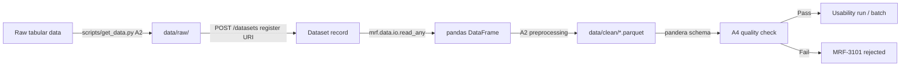

# Data conventions: format-independent interfaces

The initial design did not assume a final dataset. Candidates included German Credit, Give Me Some Credit, Taiwan credit-card default data, and SAS exports, so contracts describe generic tabular data.

## Principles

1. **Do not assume format.** DatasetFormat covers csv/tsv/parquet/feather/xlsx/xls/json/jsonl/sas7bdat/xpt/rds/rdata/sql plus other. Registration can omit format; `mrf.data.io.infer_format` uses the suffix. Contract types do not imply every reader is implemented; see completion status.
2. **Do not assume column types.** ColumnInfo.dtype accepts free pandas/SAS(NUM/CHAR)/R type names. Roles feature/target/id/weight/date/segment/score are optional.
3. **Forward reader options.** Put separators, encoding, sheets, etc. in Dataset.read_options for the reader.
4. **Retain extra metadata.** Entities have metadata dictionaries. Store unexpected information there, promoting only to optional fields once stable.
5. **Attach schemas after data selection.** A2 defines pandera schemas in mrf.data.schemas, linked by Dataset.schema_name. Without a schema, checks are generic; schema-specific ranges require a schema.
6. **Privacy.** profile_data returns statistics, not raw rows. Real data stays out of Git; fixtures are small synthetic/anonymized samples.

## Flow

