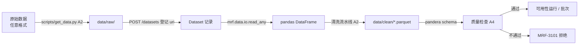

# 数据处理约定（数据集未定，先做宽泛支持）

数据集还没有最终确定。候选是 German Credit、Give Me Some Credit 和台湾信用卡违约数据，也可能用 SAS 导出数据。因此所有接口先按“任意表格数据”来设计。

## 原则

1. **不假定格式**：`DatasetFormat` 覆盖 csv/tsv/parquet/feather/xlsx/xls/json/jsonl/sas7bdat/xpt/rds/rdata/sql，未知格式归为 `other`。登记数据集时不填 `format` 也可以，系统会按后缀推断（`mrf.data.io.infer_format`）。
2. **不假定列类型**：`ColumnInfo.dtype` 是自由字符串，pandas、SAS（NUM/CHAR）、R 的类型名都接受；列角色（feature/target/id/weight/date/segment/score）可选。
3. **读取参数透传**：分隔符、编码、sheet 等写在 `Dataset.read_options` 里，原样传给读取器。
4. **兜底字段**：每个实体都带 `metadata: dict`。遇到没预料到的信息就先放进去，等稳定后再升级为正式字段（升级时只新增可选字段）。
5. **schema 后置**：pandera schema 在数据确定后由 A2 写进 `mrf.data.schemas`，并通过 `Dataset.schema_name` 关联；没有 schema 时，质量检查只做通用项（行数、缺失率、取值范围）。
6. **隐私**：`profile_data` 只返回统计量，不返回原始行；真实数据不进 git，测试夹具使用合成或匿名的小样本。

## 数据流

