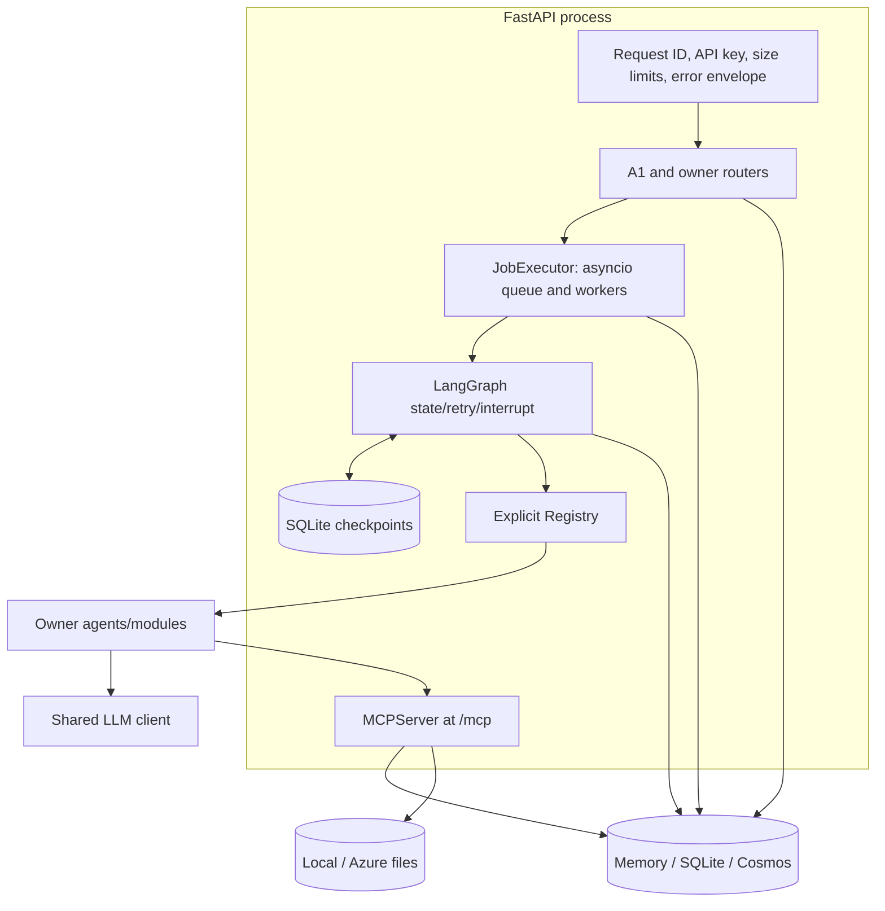
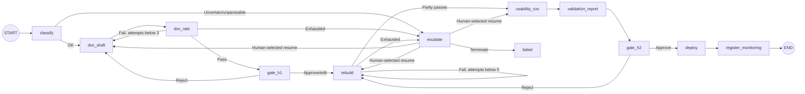
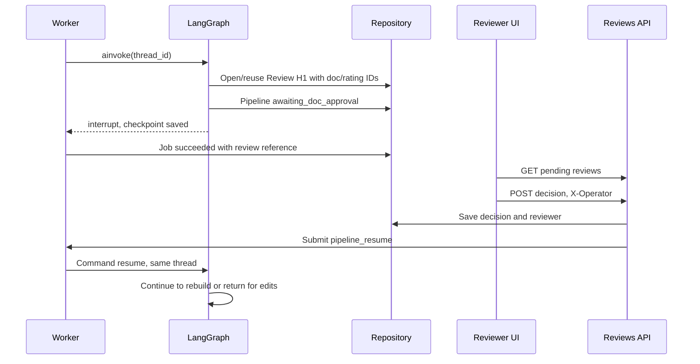

# A1 design: orchestrator, API, LLM client, storage, MCP, classification

Author: A1 Albert. Original branch: feat/a1-orchestrator. Design v0.3, November 9, 2026: sections 4-9 implemented, with Cosmos, lost-checkpoint recovery, compatible JSON mode, and App Insights additions. This document preserves the design and its evolution; current behavior is defined by code and [completion status](../completion-status.md).

Related: [execution plan](../team-execution-plan.md), [OpenAPI](../../openapi.yaml), [architecture](../architecture.md), [A1 brief](../team/A1.md).

## 0. Purpose

A1 provides the shared runtime. Uploaded code enters a pausable, resumable, auditable LangGraph workflow. A unified REST API starts/queries work; Protocols connect owner modules; MCP tools provide facts; one LLM client handles backoff, validation, and usage accounting.

## 1. Scope

| Area | Path | Delivery | Consumers |
| --- | --- | --- | --- |
| Contracts | core/contracts/OpenAPI | Envelopes, codes, states, domain models, Protocols | Everyone |
| LLM | mrf.llm | Provider selection, backoff, structured output, usage, mock | A2/A3 |
| Storage | mrf.storage | Memory/SQLite/Cosmos repositories, local/Azure files | Everyone |
| Jobs | mrf.jobs | asyncio queue, durable job records, idempotency/recovery | Routes |
| Orchestration | mrf.orchestrator | Graph, retry types, H1/H2/manual gates, audit | Workflow |
| MCP | mrf.mcp_server | /mcp, tool collection, gateway | Agents |
| Classifier | agents.classify | Static parsing + LLM extraction + confidence fusion | Graph |
| API | mrf.api | Routes, auth, request IDs, guards, pagination | UI/external callers |

A3 owns document/rating quality; A2 owns rebuild/parity algorithms; A4 owns monitoring/deployment.

## 2. Technology decisions

| Decision | Choice | Reason | Alternatives considered |
| --- | --- | --- | --- |
| Workflow | LangGraph | Conditional retries, interrupt gates, checkpoints | Custom state machine requires bespoke recovery |
| Jobs | In-process asyncio queue + DB jobs | Low infrastructure cost, single-replica demo, restart recovery | Celery/Redis complexity/cost; Storage Queue/Azurite overhead; stateless BackgroundTasks lose work |
| Persistence | Repository + JSON documents | SQLite/Cosmos alignment, additive schema evolution | Relational ORM needs another backend/mapping |
| LLM | Direct OpenAI-compatible SDK wrapper | Multi-provider, exact retry policy, testable mocks | LiteLLM dependencies/retries; thick LangChain abstraction |
| MCP | Official mcp SDK 2.x MCPServer | Maintained, Streamable HTTP, Inspector | Third-party API churn; 1.x used the FastMCP name |
| Packaging | uv | Fast reproducible lockfile and CI integration | Slower alternatives |

## 3. Overall structure



API, tool service, and workers share one process. A single replica is sufficient for the competition examples; scaling workers beyond that requires a shared queue, not merely additional containers.

## 4. Orchestrator

### 4.1 Graph



Nodes call a Protocol, persist results, record transitions, and route. Business logic belongs to the modules. H1/H2/escalation use interrupt(): persist checkpoint, pause workflow, release worker.

### 4.2 Graph state

```python
class GraphState(TypedDict, total=False):
    pipeline_id: str
    model_id: str
    attempts: dict[str, int]
    feedback: list[str]
    artifacts: dict[str, Any]
    resume_target: str | None
    failed_step: str | None
    reason_code: str | None
    reason: str | None
```

Keep IDs/counters in graph state. Full documents/code live in Repository/Blob, reducing checkpoint size and duplicated truth. Attempts/artifacts are mirrored to the Pipeline record for recovery.

### 4.3 Retry categories

Quality retries are immediate and orchestrator-counted: three drafts, five parity attempts, configured in policy. Reviewer/parity comments become next-attempt feedback.
Transient backoff is within mrf.llm: 1/2/4 seconds plus jitter for rate limits/timeouts/connection or server failures. It does not independently increment quality counters. Exhausting a client call raises an MRF error; the node counts that as a failed attempt and follows bounded routing.

| Error family | Route |
| --- | --- |
| Parse/identification/exhausted-quality/policy errors | Manual escalation |
| 3001/4001/4002/4003 in retryable steps | Count failed attempt, retry or escalate |
| 3101 quality refusal | Escalate with data-quality reason |
| Unexpected errors | failed with last_error/audit |

### 4.4 Human gates



The whole interrupted node re-executes on resume. Gate side effects must be idempotent; current implementation uses a stable review identity for that visit. Decisions require pending reviews and matching waiting pipeline state, otherwise MRF-3201. Stored review decisions remain authoritative after checkpoint loss.
Local auto_approve is only a CLI/CI convenience and does not constitute independent human sign-off.

### 4.5 Audit

A transition validates allowed states, appends StateTransition to Pipeline.history, updates step/attempts/usage, records an audit event, and emits telemetry. Historical design described append-only evidence; owner decisions must remain traceable.

## 5. Jobs and API

### 5.1 POST /pipelines

1. Validate/authenticate/screen request and source references.
2. Check idempotency key plus request hash; repeat returns original IDs, conflicting body fails.
3. Store source artifacts with hashes and create ModelRecord/Pipeline/Job.
4. Enqueue and return 202 with IDs and polling URL.
5. Worker marks running, invokes graph with pipeline thread, records completion/interruption/failure.
6. Client polls jobs for execution and pipelines for workflow state.

### 5.2 JobExecutor

Handlers are registered for pipeline, pipeline_resume, document, rebuild, run, monitoring batches/ticks. Startup requeues queued/running jobs and resumes workflow from checkpoint or persisted state. Shutdown stops taking work and allows bounded completion.
Default MRF_WORKER_CONCURRENCY is two; per-resource locks serialize a model/pipeline so resume and run do not race. Progress is stored with jobs; current exact fields follow contracts.

### 5.3 Cross-cutting behavior

| Concern | Implementation |
| --- | --- |
| Trace | Read/generate X-Request-ID; response header/envelope/log |
| Auth | require_api_key, constant-time comparison; health/readiness public |
| Idempotency | Key -> body hash/job/resource; conflicting body MRF-1006 |
| Errors | MRFError to HTTP/envelope, request validation to 1006, unexpected to 5000 without stack disclosure |
| Pagination | items plus page/page_size/total, max page size 100 |
| Guards | Supported suffixes/size, archive member/expanded-size/path checks, injection and selected PII patterns |

The early design's illustrative PII behavior was superseded by implemented guards; current source and Responsible AI note define what is scanned/rejected. Do not treat an early heuristic list as complete coverage.

## 6. Shared LLM wrapper

LLMClient.chat returns LLMResult with text, parsed structured output, and Usage. OpenAICompatClient uses AsyncOpenAI/AsyncAzureOpenAI; MockLLM provides role-based responses/faults.

1. Providers: azure_openai, openai, github_models; Azure cloud uses identity token provider. Role mapping and MRF_LLM_REVIEWER_MODEL support a separate reviewer model/context.
2. Disable SDK retries (max_retries=0) to avoid stacking with the explicit policy.
3. Validate Pydantic structured output; compatible providers may use json_object plus schema in prompt; one repair attempt remains.
4. Account prompt/completion tokens, configured EUR pricing, latency, backoff; aggregate to Pipeline.usage.
5. Mock responders support static values, sequences, callables, and injected failures; CI uses mock only.

| Provider failure | Retry | Exhausted code |
| --- | --- | --- |
| 429 | Backoff; max(policy delay, Retry-After), capped at 8s | 4002 |
| Timeout/connection/5xx | Backoff | 4001 |
| Bad request/content filtering | No transient retry | 4003 |
| Invalid JSON/schema | One repair with validation feedback, no delay | 4003 |

```python
res = await get_llm().chat(
    [ChatMessage(role="system", content=SYS), ChatMessage(role="user", content=code_excerpt)],
    role="classifier", json_schema=LLMClassification,
    metadata={"pipeline_id": ctx.pipeline_id, "step": "classify"},
)
```

## 7. Storage

Repository exposes put/get/find and optimistic versioning. BlobStore saves/retrieves artifact bytes with URI/hash metadata.

| Backend | Design | Use |
| --- | --- | --- |
| MemoryRepository | Dictionaries | Unit tests and initial integration |
| SqliteRepository | JSON documents, version, timestamps; parameterized JSON-path filtering | Local/CI |
| CosmosRepository | One precreated container per collection, /id partition, etags, parameterized queries | Cloud |

Missing resource -> MRF-1404; optimistic version conflict -> MRF-3201. This prevents concurrent review decisions from overwriting each other.
The early design considered other partition keys; section 15 records the implemented /id choice. SQLite checkpoints may be lost on container replacement, so Pipeline/Review facts permit node reentry. Demo Azure Files can retain files. Use DELETE journal on network shares, not WAL.

## 8. MCP framework

Typed async functions from ALL_TOOLS are registered with official MCPServer, whose schemas derive from signatures and descriptions from docstrings. The API mounts /mcp; its lifespan runs the session manager, one server per app to avoid reusing a one-shot manager.

Ordinary tool exceptions can be hidden by the SDK, so wrappers translate MRFError to ToolError containing the MRF code; gateways reconstruct it. InProcessGateway and HTTP gateway share call/as_openai_tools/records behavior. In-process is default for tests/single container; HTTP supports separate-service debugging.
Each gateway records tool name, parameters, timing, result/error and evidence references such as tool:search_kb#call_1. These records help verify tool-derived claims.

## 9. Classification

### 9.1 Static parsing

| Language | Identification | Structures |
| --- | --- | --- |
| SAS | .sas or PROC/DATA/RUN patterns | LOGISTIC/REG/GLM/HPSPLIT/GENMOD/SCORE, MODEL target/features, CLASS reference levels |
| R | .r/.R or assignment/library/model functions | glm binomial, lm/rpart/randomForest/xgboost, formula target/features; dot needs dataset columns |
| Python | .py/.ipynb or imports/definitions | sklearn/xgboost/statsmodels, features, fit calls; notebook code cells extracted |

Findings retain file/line ranges. SAS comments/macros require preprocessing; unresolved macro structures become warnings and lower certainty.

### 9.2 Confidence fusion

```text
c_rule = .3*[language known] + .4*[modeling procedure found] + .3*[target and features found]
c_llm = .8*LLM confidence + .2*[cited lines exist]
agreement = 1.0 when algorithm families agree; .6 when conflicting; .8 when rules lack an algorithm
confidence = agreement * (.6*c_rule + .4*c_llm)
```

Rules have more weight because they are reproducible. Disagreement reduces certainty; below .7 goes to manual review. Calibration uses inventory_gold examples, including deliberately damaged sources that should fall below threshold.

## 10. API examples and decisions

```bash
curl -X POST http://localhost:8000/api/v1/pipelines -H "X-API-Key: $MRF_API_KEY" -H "Idempotency-Key: m001-upload-1" -F "files=@models/legacy/M001_sas_pd_scorecard/m001_pd_scorecard.sas" -F "model_name=M001 PD Scorecard" -F "owner=credit-risk"
```

Accepted envelope includes request_id/status=accepted/code=MRF-0202, pipeline/model/job IDs, poll, errors[], warnings[]. Query the pipeline for current_step, state, history, attempts, usage; these are illustrative fields, not measured KPI claims.

```bash
curl "http://localhost:8000/api/v1/reviews?status=pending&gate=H1" -H "X-API-Key: $MRF_API_KEY"
curl -X POST http://localhost:8000/api/v1/reviews/<review-id>/decision -H "X-API-Key: $MRF_API_KEY" -H "X-Operator: reviewer" -H "Content-Type: application/json" -d '{"decision":"reject","comment":"Explain the limitations of the sample period."}'
```

| Decision | H1 | H2 | Manual |
| --- | --- | --- | --- |
| approve | Rebuild | Register/monitor | Resume selected/default failed step, reset relevant counter |
| reject | Redraft with feedback | Rebuild with feedback | Failed |
| edit | Apply section edits then rebuild | Unsupported, 1006 | Apply classification edits, resume target |

GET jobs returns status/progress/result/error; GET models?needs_review=true finds uncertain identification; classification evidence references code lines.

## 11. Code layout

The original proposed files were consolidated during implementation. Current main locations:

```text
llm/              base.py openai_client.py mock.py usage.py
storage/          base.py memory.py sqlite.py cosmos.py blobs.py azure_blobs.py
api/              app.py deps.py routers/
orchestrator/     graph.py service.py registry.py handlers.py stubs.py
mcp_server/       server.py client.py tools/
agents/classify/  agent.py parsers.py
jobs.py           Executor and handlers
tests/            Unit and integration coverage
```

## 12. Testing strategy

| Area | Verification |
| --- | --- |
| LLM | Backoff/jitter/Retry-After/errors/repair using injected faults and recorded sleeps |
| Graph | Every pass/retry/exhaustion/rejection/manual-resume/unexpected-error edge with controlled Protocol doubles |
| Gates | Real temporary SQLite checkpoints, restart/replay, no duplicate review, repeated decision conflict |
| API | Envelopes, idempotency same/conflicting body, auth, pagination, guards via TestClient |
| Identification | Four gold fixtures, damaged low-confidence cases |
| End-to-end | M001 through monitoring using mock provider; real modules tested separately from provider quality |

## 13. Original catch-up schedule

| Date | A1 milestone | Team benefit |
| --- | --- | --- |
| Nov 5 | Contracts/skeleton/design | Work against Protocols/doubles |
| Nov 5-6 | LLM/mock, memory repo, graph/stubs, CLI | Agents can call client and run nodes |
| Nov 6 | Classifier/parser, SQLite, jobs/routes/MCP | Registered tools callable |
| Nov 6 evening | Retries/gates/manual/audit/full branch tests | MVP integration base |
| Nov 7 | MVP | Joint demo |

The original Nov 3-4 tasks were being caught up without changing the Nov 7 target; these are historical planning dates.

## 14. Risks and trade-offs

| Risk | Approach |
| --- | --- |
| Single-process scale | Sufficient for prototype; future shared queue/independent workers |
| Checkpoint loss | Reenter from durable Pipeline/Review facts; Azure Files for retained demo state |
| Gate replay duplicates | Idempotent side effects and stable review identities |
| Azure provider unavailable | Environment-configured OpenAI-compatible/GitHub alternatives |
| Contract changes | Add optional fields only, A1 review, team synchronization |
| Writer/reviewer bias | Separate prompt/context/model option, 60% deterministic rules and vetoes |

## 15. November 9 additions

| Topic | Implemented detail | Location |
| --- | --- | --- |
| Cosmos | /id partition, etag concurrency, parameterized SQL; containers precreated in Bicep because identity cannot create them | storage/cosmos.py |
| Lost-checkpoint recovery | Mirror attempts/artifacts to Pipeline; record Review decisions; start/resume use STATE_NODES without checkpoint | orchestrator/graph.py |
| Network SQLite | MRF_SQLITE_JOURNAL_MODE=DELETE; switch checkpoint journal after setup overrides WAL | sqlite.py, service.py |
| Compatible JSON | auto uses json_schema on Azure/OpenAI, json_object plus prompted schema elsewhere; validation/repair retained | llm/openai_client.py |
| App Insights | Optional APPLICATIONINSIGHTS_CONNECTION_STRING, node spans, audit events | telemetry.py |
| Offline agents | MockLLM.register_default(role, fn), explicit test responders take precedence | llm/mock.py |
