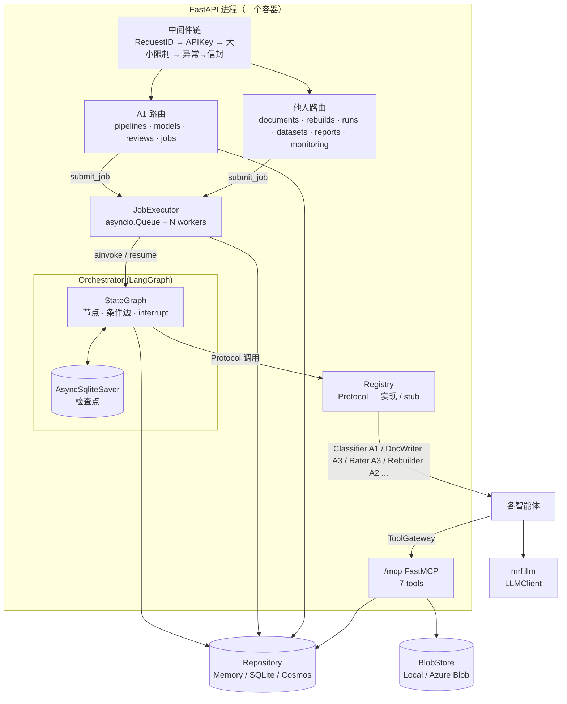
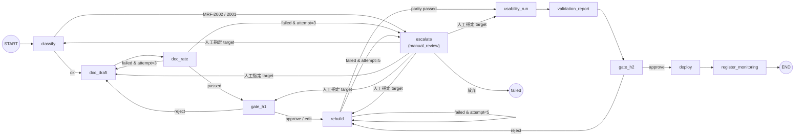
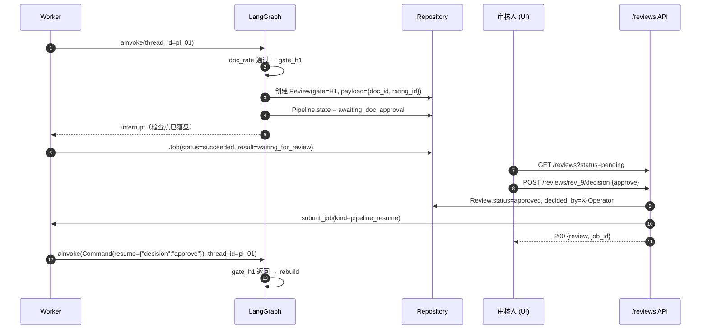
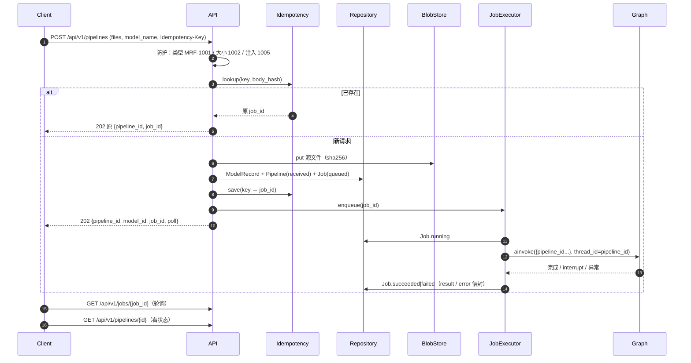
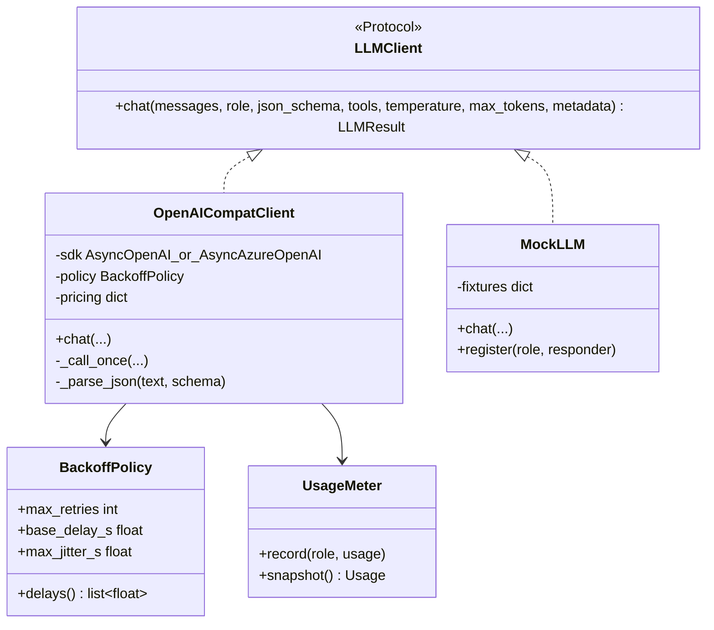
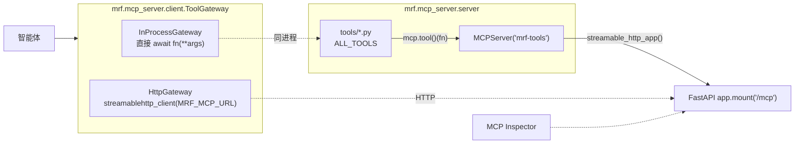
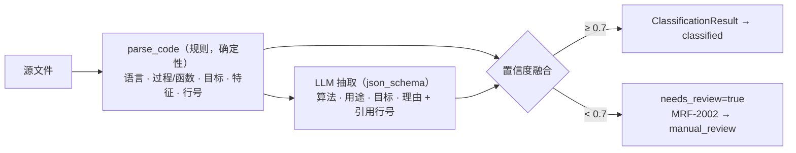

# A1 设计文档 — 编排器 · 统一 API · LLM 封装 · 存储 · MCP 框架 · 识别智能体

作者：A1 Albert · 分支 `feat/a1-orchestrator` · 状态：v0.2（2026-11-05，§4–8 已实现，§9 识别智能体待实现）
相关：[执行计划](../../C04%20A队执行计划%20—%20智能体模型风险工厂.md) · [openapi.yaml](../../openapi.yaml) · [架构总览](../architecture.md) · [A1 任务书](../team/A1.md)

---

## 0. 一句话

A1 负责“骨架和神经”。它把一份上传的代码变成一条**可暂停、可恢复、可审计**的 LangGraph 流水线：外部通过统一 REST API 发起和查询，内部通过 Protocol 调用 A2/A3/A4 的模块，智能体通过 MCP 工具取数，所有 LLM 调用都走同一个带退让和计费的封装。

## 1. 范围

| 模块 | 路径 | 我交付什么 | 谁依赖 |
| --- | --- | --- | --- |
| 契约 | `mrf.core`、`mrf.contracts`、`openapi.yaml` | 信封、返回码、状态机、领域模型、Protocol（**已在 main**） | 全员 |
| LLM 封装 | `mrf.llm` | `get_llm().chat()`：多供应商、指数退让、JSON 输出校验、token/费用、Mock | A2 A3 |
| 存储 | `mrf.storage` | `Repository`（内存 / SQLite / Cosmos）、`BlobStore`（本地 / Azure Blob） | 全员 |
| 任务执行器 | `mrf.api.jobs` | asyncio 队列 + jobs 表、幂等、启动恢复 | API 各路由 |
| 编排器 | `mrf.orchestrator` | LangGraph 图、两类重试、H1/H2 关卡、人工队列、审计 | — |
| MCP 框架 | `mrf.mcp_server` | FastMCP 服务挂 `/mcp`、工具自动注册、`ToolGateway` 客户端 | A2 A3 智能体 |
| 识别智能体 | `mrf.agents.classify` | 静态解析 + LLM 抽取 + 置信度融合 | 编排器 |
| API | `mrf.api` | A1 端点 + 横切（鉴权、幂等、追踪、输入防护、分页） | UI、外部 |

不在范围内：说明书和评级的内容质量（A3）、重建和一致性算法（A2）、监控指标与部署（A4）。

## 2. 技术选型（已确认）

| 决策点 | 选择 | 主要理由 | 放弃的方案及原因 |
| --- | --- | --- | --- |
| 编排框架 | **LangGraph**（计划已定） | 原生支持状态图、条件边（重试循环）、`interrupt` 人工关卡、检查点恢复 | 自写状态机：中断恢复和检查点都要自己造 |
| 任务执行器 | **进程内 asyncio 队列 + DB jobs 表** | 零额外基础设施；Container Apps 单副本足够；重启后靠 jobs 表 + LangGraph 检查点续跑 | Celery+Redis 超预算且配置重；Storage Queue 本地要 Azurite、链路长；BackgroundTasks 无状态、重启即丢 |
| 持久化 | **Repository 协议 + 文档式存储**（SQLite JSON 列 / Cosmos） | 和 Cosmos 文档模型一一对应，切换只改配置；schema 演进成本低 | ORM：Cosmos 非关系库，要么换 Postgres（无免费层），要么写两套映射；纯 SQLite：网络盘上的锁不可靠 |
| LLM 底座 | **openai SDK 直连 + 自写封装** | 一个 SDK 覆盖 Azure OpenAI、OpenAI、GitHub Models；重试规则可以严格实现计划里的 1s/2s/4s；Mock 好做 | LiteLLM 依赖重，且自带重试会和我们的分类重试叠加；LangChain 抽象层厚、token 细节被包住 |
| MCP 框架 | **官方 `mcp` SDK 2.x（`MCPServer`，即 1.x 的 FastMCP）** | 官方维护、规范跟进快、内置 Streamable HTTP，MCP Inspector 兼容最好 | fastmcp 2.x 功能多但 API 变化快，和官方 SDK 并存容易混淆 |
| 包管理 | uv（已在仓库） | 安装快、`uv.lock` 可复现、CI 有官方 action | poetry / pip-tools 更慢 |

## 3. 总体结构



一个容器里跑 API、工具服务和 worker。比赛规模是 4–5 个模型，单副本已经足够；拆成多个容器只是部署形态的变化，代码不用改。

## 4. 编排器（核心）

### 4.1 图结构



- 每个节点 = 一个流水线步骤，节点只做 3 件事：调用 Protocol、写结果到 Repository、更新图状态。**节点本身不含业务逻辑**。
- `escalate`、`gate_h1`、`gate_h2` 都调用 LangGraph 的 `interrupt()`。图在这里暂停，检查点落盘，worker 释放。

### 4.2 图状态

```python
class GraphState(TypedDict, total=False):
    pipeline_id: str
    model_id: str
    state: PipelineState  # 对外可见的状态，镜像到 Pipeline 文档
    attempts: dict[str, int]  # {"doc": 2, "parity": 1}
    feedback: list[str]  # 上一次失败的意见（评级 comments / parity diff / 人工驳回）
    artifacts: dict[str, str]  # doc_id, rating_id, rebuild_id, run_id, report_id ...
    last_error: dict | None  # {"code": "MRF-3001", "message": ...}
    resume_target: str | None  # 人工从 manual_review 指定的恢复节点
```

图状态只放 **id 和计数**，大对象（说明书全文、代码）存 Repository 和 Blob。这样检查点很小，也避免两份数据不一致。

### 4.3 两类重试分开计数

```mermaid
flowchart TB
    subgraph Q["质量重试：编排器计数，不等待"]
      direction LR
      d1["draft 1"] --> r1{"rate"} -->|"不通过 + comments"| d2["draft 2"] --> r2{"rate"} -->|"不通过"| d3["draft 3"] --> r3{"rate"} -->|"不通过"| M["manual_review MRF-2101"]
    end
    subgraph T["瞬时重试：mrf.llm 内部，对编排器透明"]
      direction LR
      c0["LLM 调用"] -->|"429 / 超时 / 5xx"| w1["等 1s + 抖动"] --> c1["重试"] -->|"仍失败"| w2["等 2s + 抖动"] --> c2["重试"] -->|"仍失败"| w3["等 4s + 抖动"] --> c3["重试"] -->|"仍失败"| X["MRFError 4001/4002"]
    end
```



- **质量重试**：由 `policy.py` 读取 `config/pipeline.yaml`（说明书 3 次、一致性 5 次）。条件边函数：

  ```python
  def after_rate(s: GraphState) -> str:
      if s["artifacts"].get("rating_passed"):
          return "gate_h1"
      return "doc_draft" if s["attempts"]["doc"] < policy.doc_max else "escalate"
  ```

- **瞬时重试**：只在 `mrf.llm` 里发生，不增加 `attempts`。如果瞬时重试用尽、抛出 4001/4002，节点会把这次计为一次**失败尝试**，然后照常走质量重试的路由。这样 LLM 持续限流时不会无限循环。
- 一个节点里出现 `MRFError` 时，按返回码分流：

  | 返回码类别 | 去向 |
  | --- | --- |
  | 2001 / 2002 / 2101 / 3002 / 3003 | `escalate`（人工） |
  | 3001 / 4001 / 4002 / 4003 | 记一次失败尝试，按重试规则分流 |
  | 3101 | `escalate`，原因是“数据质量” |
  | 5000 / 未知异常 | `failed`，`last_error` 写清楚，审计留痕 |

### 4.4 人工关卡（H1 / H2 / manual）



- 关卡节点代码：

  ```python
  async def gate_h1(s: GraphState) -> Command:
      review = await reviews.open(s, gate=Gate.H1, payload={...})  # 幂等：重放时复用同一个 review
      decision = interrupt({"review_id": review.review_id})  # 暂停点
      if decision["decision"] == "reject":
          return Command(goto="doc_draft", update={"feedback": [decision.get("comment", "")]})
      if decision["decision"] == "edit":
          await docs.apply_edits(s["artifacts"]["doc_id"], decision["edits"])
      return Command(goto="rebuild", update={"state": PipelineState.REBUILDING})
  ```

- LangGraph 恢复时会**重新执行整个中断节点**，所以 `interrupt()` 之前的副作用必须幂等：`reviews.open` 先按 `(pipeline_id, gate, attempt)` 查找，已有就直接复用。
- 状态校验：只能对 `status=pending` 的 review 做决定；pipeline 也必须处于对应的等待状态，否则返回 `MRF-3201`。
- `MRF_ENV=local` 且 `options.auto_approve=true` 时，worker 收到中断后会自动以 `approve` 恢复（用于 CLI 和 CI 端到端测试）。

### 4.5 审计

每次状态迁移都调用 `audit.transition(pipeline, to_state, actor, code, note)`，它会：

1. 用 `can_transition()` 校验迁移合法（防御性检查，非法即 `MRF-5000`）
2. 在 `Pipeline.history` 中追加一条 `StateTransition`，更新 `state`、`current_step`、`attempts`、`usage`
3. 写入 `audit` 集合（只追加不修改，供 RAI 说明和问答取证）
4. 发出一个 OpenTelemetry span 事件（A4 把它接到 App Insights）

## 5. 任务执行器与 API 流程

### 5.1 POST /pipelines 端到端



### 5.2 JobExecutor

```python
class JobExecutor:
    def __init__(self, repo: Repository, concurrency: int): ...
    async def start(self) -> None:       # FastAPI lifespan 中调用：拉起 N 个 worker，并恢复未完成任务
    async def stop(self) -> None:        # 优雅关闭：不再取新任务，等当前任务完成（有超时）
    async def submit(self, kind: str, resource: dict, handler: str,
                     idempotency_key: str | None = None) -> Job: ...

HANDLERS: dict[str, Callable[[Job], Awaitable[dict]]] = {
    "pipeline": run_pipeline,             # A1
    "pipeline_resume": resume_pipeline,   # A1
    "document": regenerate_document,      # A3 提供函数，A1 注册
    "rebuild": run_rebuild,               # A2
    "run": run_model,                     # A2
}
```

- **启动恢复**：把 `status in (queued, running)` 的 job 全部重新入队。`running` 的 pipeline job 从 LangGraph 检查点续跑（同一个 `thread_id`），已完成的节点不会重做。
- **并发**：`MRF_WORKER_CONCURRENCY`（默认 2）。同一个 `pipeline_id` 用 `asyncio.Lock` 串行，防止 resume 和 run 同时操作一张图。
- **进度**：节点完成后更新 `Job.progress`（已完成步骤数 / 11）。

### 5.3 横切规则

| 规则 | 实现 |
| --- | --- |
| 追踪 | 中间件读 `X-Request-ID`，没有就生成；同时写回响应头和信封（**已实现**） |
| 鉴权 | 依赖 `require_api_key`，比较时用 `secrets.compare_digest`；`/healthz` `/readyz` 免鉴权 |
| 幂等 | `idempotency` 集合：`key → {body_sha256, job_id, resource}`。同 key 不同 body → `MRF-1006` |
| 异常 | `MRFError` → 对应 HTTP + 信封（**已实现**）；`RequestValidationError` → `MRF-1006`（**已实现**）；其他异常 → `MRF-5000`，不泄露堆栈 |
| 分页 | `Paged[T] = {items, pagination{page, page_size, total}}`，`page_size ≤ 100` |
| 输入防护 | 后缀白名单（.sas .r .R .py .ipynb .txt .zip）；大小 ≤ `MRF_MAX_UPLOAD_MB`；zip 检查解压炸弹和路径穿越；注入启发式（“ignore previous instructions”类模式，仅针对注释和字符串）→ 1005；个人数据正则（邮箱、电话、IBAN、PPS）→ 1004（数据集只告警，代码中出现则拒绝） |

## 6. LLM 封装

### 6.1 结构



### 6.2 关键行为

1. **供应商**：`azure_openai`（`AsyncAzureOpenAI`，云端用 `azure-identity` 的 token provider，不放 key）、`openai`、`github_models`（都是 `AsyncOpenAI(base_url=...)`）。`role` 映射到模型，例如 `rater` 可以单独配 `MRF_LLM_REVIEWER_MODEL`，满足“独立评审”的要求。
2. **关闭 SDK 自带重试**：openai SDK 默认 `max_retries=2`，必须设为 `0`，否则会和我们的退让叠加，计划里的 1s/2s/4s 就失真了。
3. **错误分类**：

   | SDK 异常 | 是否退让 | 用尽后的返回码 |
   | --- | --- | --- |
   | `RateLimitError` (429) | 是；如果有 `Retry-After` 则取 max(它, 计划值)，上限 8s | MRF-4002 |
   | `APITimeoutError`、`APIConnectionError` | 是 | MRF-4001 |
   | `InternalServerError` (5xx) | 是 | MRF-4001 |
   | `BadRequestError`（含内容过滤） | 否 | MRF-4003 |
   | JSON 不合 schema | 不等待，带校验错误“修复重问” 1 次 | MRF-4003 |

4. **结构化输出**：传入 `json_schema`（Pydantic 类）时，用 `response_format={"type":"json_schema",...}`，再用 `Model.model_validate_json` 校验，结果放在 `res.parsed`。
5. **计费**：每次调用把 `usage.prompt_tokens/completion_tokens`、按 `config` 中单价算出的 `cost_eur`、`latency_ms`、`backoff_retries` 计入 `UsageMeter`。节点结束时汇总到 `Pipeline.usage`，作为 11/11 评估“流程提升”的数据来源。
6. **MockLLM**：按 `role` 注册响应（静态 JSON、或一个函数 `messages → 响应`），还可以注入故障（例如“前 2 次 429”），专门用来测试退让和重试分支。CI 只用 mock。

```python
res = await get_llm().chat(
    [ChatMessage(role="system", content=SYS), ChatMessage(role="user", content=code_excerpt)],
    role="classifier",
    json_schema=LLMClassification,
    metadata={"pipeline_id": ctx.pipeline_id, "step": "classify"},
)
```

## 7. 存储

```python
class Repository(Protocol):
    async def put(self, collection: str, doc_id: str, doc: BaseModel, *, if_version: int | None = None) -> int
    async def get(self, collection: str, doc_id: str, model: type[T]) -> T            # 不存在 → MRF-1404
    async def find(self, collection: str, model: type[T], *, where: dict[str, Any] | None = None,
                   page: int = 1, page_size: int = 20, order_by: str = "-created_at") -> Page[T]
    async def append(self, collection: str, doc: BaseModel) -> None                    # audit 只追加

class BlobStore(Protocol):
    async def put_bytes(self, path: str, data: bytes, media_type: str = ...) -> ArtifactRef
    async def get_bytes(self, uri: str) -> bytes
```

| 后端 | 实现 | 用途 |
| --- | --- | --- |
| `MemoryRepository` | dict | 单元测试；11/3 起先给队友用 |
| `SqliteRepository` | 每个集合一张表 `(id TEXT PK, data JSON, version INT, created_at, updated_at)`；`where` 翻译成 `json_extract(data,'$.state') = ?` | 本地、CI |
| `CosmosRepository` | 每个集合一个 container，分区键 `/model_id`（monitoring 用 `/model_id`，audit 用 `/pipeline_id`）；`if_version` 映射为 `etag` | 云端 |

- **乐观并发**：`version` 每写一次 +1；`if_version` 不匹配 → `MRF-3201`。用来防止两个审核人同时批准同一个 review。
- **LangGraph 检查点**：本地和 dev 用 `AsyncSqliteSaver`（单副本时写在容器本地盘）。容器重建会丢失检查点，但 Pipeline 文档里保存了 `state` 和 `artifacts`，可以从当前状态对应的节点重新进入图（`resume_target`），所以不需要自己写 Cosmos 检查点。这是有意的取舍，demo 环境另外挂 Azure Files 来保留检查点文件。

## 8. MCP 工具服务框架



- **注册**：负责人只需在 `tools/<area>.py` 里写带类型注解和 docstring 的 async 函数，并加入 `ALL_TOOLS`。FastMCP 会根据签名生成 JSON Schema，docstring 就是 LLM 看到的工具描述。
- **挂载**：`app.mount("/mcp", server.streamable_http_app(streamable_http_path="/", stateless_http=True, json_response=True))`，避免路径变成 `/mcp/mcp`；FastAPI 的 lifespan 里要 `async with server.session_manager.run():`。每个 app 新建一个 server，因为一个 session manager 只能 run 一次。
- **错误透传**：SDK 会把工具抛出的普通异常隐藏成 “Error executing tool”，所以注册时包了一层，把 `MRFError` 转成 `ToolError("MRF-xxxx: …")`；客户端再从文本中解析出返回码，还原成 `MRFError`。
- **ToolGateway**：`MRF_TOOL_TRANSPORT=inprocess`（默认，测试和单容器部署都用它，没有网络开销）或 `http`（工具服务独立部署时使用）。两者接口相同：

  ```python
  class ToolGateway(Protocol):
      async def call(self, name: str, **arguments: Any) -> Any
      async def as_openai_tools(self, names: list[str] | None = None) -> list[dict]   # 给 function calling
      def calls(self) -> list[ToolCallRecord]     # 本次步骤的调用记录 → Evidence(source="tool", ref="tool:<name>#call_<n>")
  ```

- **统一包装**：网关负责超时、`MRFError` 透传、调用计时和调用记录。说明书里“数字必须来自工具”的规则，就靠这份调用记录来核对。

## 9. 识别智能体



### 9.1 `parse_code` 规则（第一版）

| 语言判断 | 依据 |
| --- | --- |
| SAS | 后缀 `.sas`；或 `PROC \w+`、`DATA \w+;`、`RUN;` 的出现密度 |
| R | 后缀 `.r/.R`；或 `<-`、`library(`、`glm(` |
| Python | 后缀 `.py/.ipynb`；或 `import`/`def`，ipynb 先抽出代码单元 |

| 识别目标 | SAS | R | Python |
| --- | --- | --- | --- |
| 过程 | `PROC LOGISTIC / REG / GLM / HPSPLIT / GENMOD / SCORE` | `glm(… family=binomial)`、`lm(`、`rpart(`、`randomForest(`、`xgboost(` | `LogisticRegression`、`XGBClassifier`、`DecisionTreeClassifier`、`statsmodels.Logit` |
| 目标 / 特征 | `MODEL y(event='1') = x1 x2 …;`、`CLASS` 语句（参照水平） | 公式 `y ~ x1 + x2`，`.` 展开需要数据列 | `fit(X[cols], y)`、`features = [...]` |
| 证据 | 每个识别结果都附 `file:line_start-line_end` | 同左 | 同左 |

SAS 的注释（`/* */`、`* …;`）、宏变量（`&var`）和 `%macro` 先做预处理；无法展开的宏放进 `warnings`，并降低置信度。

### 9.2 置信度融合

```text
c_rule = 0.3·[语言确定] + 0.4·[识别到建模过程] + 0.3·[目标与特征都找到]
c_llm  = LLM 自评分 · 0.8 + 0.2·[LLM 引用的行号都真实存在]
agree  = 1.0  如果 LLM 的算法 ∈ 过程对应的算法集合，否则 0.6
c      = agree · (0.6·c_rule + 0.4·c_llm)
```

规则信号权重更高，是因为它可以复现；LLM 和规则不一致时整体打折，从而触发人工审核。权重通过 A2 的 `inventory_gold.json` 在 11/4 校准，目标是 4 个模型全部正确，且故意改坏的样本（删掉 MODEL 语句）会掉到 0.7 以下。

## 10. A1 端点详解（示例）

### 10.1 启动流水线

```bash
curl -X POST http://localhost:8000/api/v1/pipelines \
  -H "X-API-Key: $MRF_API_KEY" -H "Idempotency-Key: m001-upload-1" \
  -F "files=@models/legacy/M001_sas_pd_scorecard/model.sas" \
  -F "model_name=M001 PD Scorecard" -F "owner=credit-risk" \
  -F 'options={"rebuild": true}'
```

```json
{
  "request_id": "5b0c8f7e-3f1a-4c0b-9d7e-1c2f8a9e4b11",
  "status": "accepted", "code": "MRF-0202", "message": "Pipeline started",
  "data": {"pipeline_id": "pl_6729a1f0c3d2", "model_id": "mdl_6729a1f0a91b",
           "job_id": "job_6729a1f07e44", "poll": "/api/v1/jobs/job_6729a1f07e44"},
  "errors": [], "warnings": []
}
```

### 10.2 查询流水线

`GET /api/v1/pipelines/pl_6729a1f0c3d2` →

```json
{
  "status": "success", "code": "MRF-0000",
  "data": {
    "pipeline_id": "pl_6729a1f0c3d2", "model_id": "mdl_6729a1f0a91b",
    "state": "awaiting_doc_approval", "current_step": "gate_h1",
    "attempts": {"doc": 2},
    "history": [
      {"from_state": null, "to_state": "received", "actor": "api"},
      {"from_state": "received", "to_state": "classified", "actor": "system"},
      {"from_state": "doc_rating", "to_state": "doc_drafting", "code": null, "note": "score 72 < 80"},
      {"from_state": "doc_rating", "to_state": "awaiting_doc_approval", "note": "score 86"}
    ],
    "usage": {"prompt_tokens": 18234, "completion_tokens": 5120, "cost_eur": 0.021, "llm_calls": 6, "backoff_retries": 1}
  }
}
```

### 10.3 审核队列与决定

```bash
curl "http://localhost:8000/api/v1/reviews?status=pending&gate=H1" -H "X-API-Key: $MRF_API_KEY"

curl -X POST http://localhost:8000/api/v1/reviews/rev_6729a2b1/decision \
  -H "X-API-Key: $MRF_API_KEY" -H "X-Operator: albert" -H "Content-Type: application/json" \
  -d '{"decision": "reject", "comment": "Limitations 未提到样本期 2008 危机"}'
```

返回 `200 {review: {...status: "rejected"}, job_id: "job_..."}`。随后流水线回到 `doc_drafting`，这条意见会进入下一次 `ctx.feedback`。

| decision | H1 | H2 | manual |
| --- | --- | --- | --- |
| approve | → rebuilding | → deployed | → `target_state`（默认回到失败的那一步）；尝试计数清零 |
| reject | → doc_drafting（附意见） | → rebuilding（附意见） | → failed |
| edit | 应用 `edits.sections` 后 → rebuilding | 不支持（MRF-1006） | 应用 `edits.classification` 后 → `target_state` |

### 10.4 任务与清单

- `GET /api/v1/jobs/{id}` → `Job{status, progress, result, error}`；`error` 本身是一个信封片段 `{code, message}`
- `GET /api/v1/models?needs_review=true` → 识别置信度不足的模型
- `GET /api/v1/models/{id}` → `ModelRecord`，其中 `classification.evidence` 可以直接链接到代码行

## 11. 代码布局（本分支要新增的文件）

```text
src/mrf/
  llm/        client.py  backoff.py  mock.py  pricing.py
  storage/    base.py  memory.py  sqlite.py  cosmos.py  blobs.py
  api/        deps.py  jobs.py  idempotency.py  guards.py  pagination.py
              routers/{pipelines,models,reviews,jobs}.py   （补充路径操作）
  orchestrator/ state.py  graph.py  nodes.py  policy.py  gates.py  audit.py  registry.py  stubs.py
  mcp_server/ server.py  client.py
  agents/classify/ parser_sas.py  parser_r.py  parser_py.py  agent.py  prompts.py
tests/unit/   test_llm_backoff.py  test_storage_*.py  test_graph_paths.py  test_gates.py
              test_idempotency.py  test_classify_*.py
tests/integration/ test_pipeline_e2e_mock.py   （API → job → 图 → auto_approve → monitoring）
```

## 12. 测试策略

| 层 | 测什么 | 怎么测 |
| --- | --- | --- |
| LLM 封装 | 1/2/4s 退让、抖动范围、`Retry-After`、错误码映射、JSON 修复 | MockLLM 注入故障，`asyncio.sleep` 打桩记录延迟 |
| 状态机 | **每条边**：通过、3 次失败转人工、5 次失败转人工、H1 驳回、H2 驳回、人工恢复、未知异常进 failed | stub Protocol 用脚本控制结果，断言 `history` 序列 |
| 关卡 | 中断后重启进程再恢复；重放不重复创建 review；重复决定返回 3201 | 真实 `AsyncSqliteSaver` + 临时目录 |
| API | 信封形状、幂等（同 key 同 body / 不同 body）、鉴权、分页、输入防护 | `TestClient` |
| 识别 | 4 个遗留模型与 gold 一致；改坏样本 < 0.7 | A2 夹具 |
| 端到端 | mock 下 M001 跑到 `monitoring` | 集成测试，CI 中运行 |

## 13. 交付节奏

| 日期 | A1 本分支里程碑 | 对队友的意义 |
| --- | --- | --- |
| 11/5 今天 | 骨架与契约已上 main；本设计文档 | 大家可以基于 Protocol 和 stub 开工 |
| 11/5–6 | `mrf.llm` + MockLLM、`MemoryRepository`、图与 stub 节点、`python -m mrf.run --model M001` 空跑 | A2/A3 可以调用 LLM 并跑通自己的节点 |
| 11/6 | 识别智能体 + `parse_code`；SQLite 存储；JobExecutor；A1 端点；MCP 框架 | 工具注册即可被智能体调用 |
| 11/6 晚 | 重试、H1/H2、人工队列、审计；状态机全分支测试 | MVP 前的集成基座 |
| 11/7 | MVP 集成 | — |

（原计划 11/3–11/4 的部分今天开始补。到 11/6 晚上必须追平，不影响 11/7 MVP。）

## 14. 风险与取舍

| 风险 / 取舍 | 应对 |
| --- | --- |
| 单进程执行器无法横向扩展 | 比赛规模足够；Repository 和图都是无状态设计，以后可以换成 Storage Queue + 独立 worker，handler 不用改 |
| 容器重建丢失 SQLite 检查点 | 用 Pipeline 文档里的 `state` + `artifacts` 从对应节点重新进入；demo 挂 Azure Files |
| LangGraph 恢复时重跑中断节点，副作用重复 | 关卡节点里的副作用全部做成按 `(pipeline_id, gate, attempt)` 幂等 |
| 学生订阅没有 Azure OpenAI | 封装层已支持 OpenAI / GitHub Models，切换只改环境变量 |
| 契约在开发中需要变化 | 只允许新增可选字段；由 A1 审批，并在站会上同步 |
| LLM 生成与评审用同一个模型 | `role=rater` 可以单独配模型和独立提示词；规则分占 60% 且有否决项（A3） |
