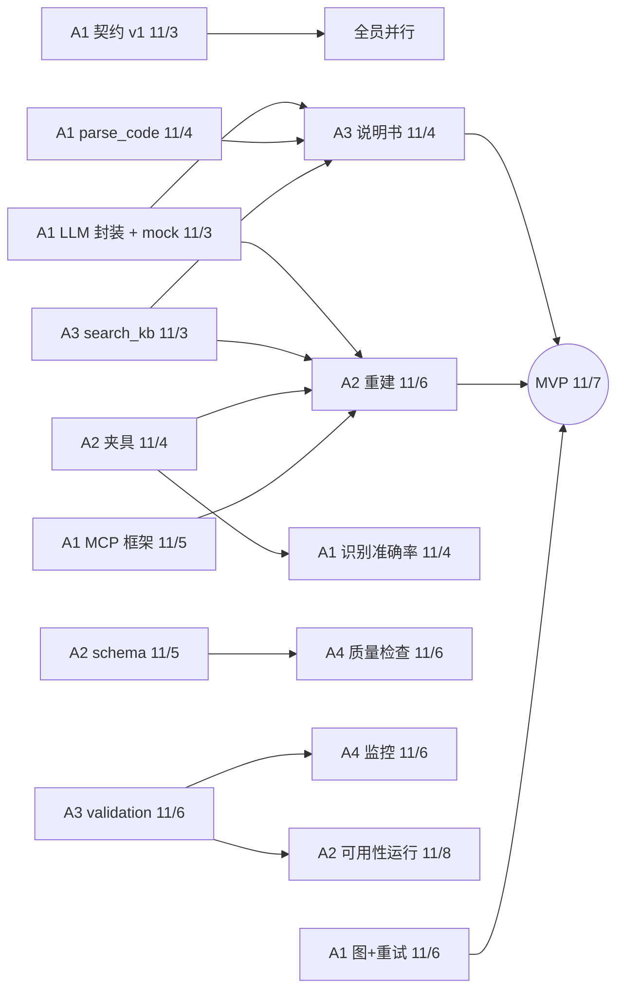

# 分工与接口总表

每人拥有流水线中的一段。所有对接只通过 3 种契约进行，契约 v1 在 11/3 冻结：

1. **REST API**：[openapi.yaml](../../openapi.yaml)，供外部和 UI 调用
2. **Python 接口**：[src/mrf/contracts/agents.py](../../src/mrf/contracts/agents.py)，编排器调用各模块；领域模型见 [contracts/models.py](../../src/mrf/contracts/models.py)
3. **MCP 工具**：[src/mrf/mcp_server/tools/](../../src/mrf/mcp_server/tools/)，智能体通过它取数

个人任务书：[A1](A1.md) · [A2](A2.md) · [A3](A3.md) · [A4](A4.md) · **[接入指南（怎么把你的模块接进流水线）](integration.md)**

## 谁实现、谁调用

| 契约 | 实现者 | 调用者 | 交付日 |
| --- | --- | --- | --- |
| `Classifier.classify` | A1 | 编排器 | 11/4 |
| `DocWriter.draft` | A3 | 编排器、`POST /documents` | 11/4 |
| `Rater.rate` | A3 | 编排器 | 11/5 |
| `Rebuilder.rebuild` | A2 | 编排器、`POST /rebuilds` | 11/6 |
| `ModelRunner.run` | A2 | 编排器、`POST /runs`、A4 定时任务 | 11/8 |
| `ReportBuilder.build` | A3（分析/验证）、A4（监控） | 编排器、定时任务 | 11/8–9 |
| `DataQualityChecker.check` | A4 | `ModelRunner`（运行前）、`GET /quality` | 11/6 |
| `MonitoringRegistrar.register` | A4 | 编排器（deployed 之后） | 11/8 |
| `mrf.llm.get_llm().chat` | A1 | 所有智能体 | 11/3 |
| `mrf.storage.get_repo()` / `get_blobs()` | A1 | 所有模块 | 11/5（11/3 起可用内存版） |
| `mrf.validation.*`（PSI/CSI 等） | A3 | A2 运行、A4 监控、`compute_metrics` | 11/6 |
| `mrf.data.io.read_any` + `mrf.data.schemas` | A2 | `profile_data`、A4 质量检查 | 11/5 |
| MCP `parse_code` `get_inventory` | A1 | 识别、说明书、评级 | 11/4 |
| MCP `profile_data` | A2 | 说明书 | 11/5 |
| MCP `run_sandbox` `run_parity` | A2 | 重建 | 11/6 |
| MCP `search_kb` | A3 | 说明书、重建 | 11/3 |
| MCP `compute_metrics` | A3 | 运行、报告 | 11/6 |

## 依赖关系（谁等谁）

在依赖交付之前，每个人都先用 stub 或 mock 开发：编排器自带每个 Protocol 的 stub 实现，`MRF_LLM_PROVIDER=mock` 不需要网络。

## 通用完成标准（Definition of Done）

- 实现 Protocol / 工具的签名与 docstring 一致，失败时 `raise MRFError`
- 单元测试使用 mock LLM，CI 绿
- 新增数字、阈值都写进 `config/pipeline.yaml`
- PR 有搭档审阅；涉及契约文件的需要 A1 批准
