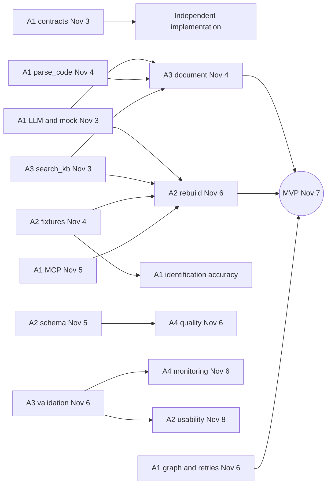

# Team responsibilities and interfaces

Each member owns a workflow segment. Three contracts, frozen as v1 on November 3, define integration:

1. [REST API](../../openapi.yaml) for external callers and UI.
2. [Python Protocols](../../src/mrf/contracts/agents.py) for orchestration; [domain models](../../src/mrf/contracts/models.py).
3. [MCP tools](../../src/mrf/mcp_server/tools/) for agent access to facts.

Task briefs: [A1](A1.md), [A2](A2.md), [A3](A3.md), [A4](A4.md). [Module integration guide](integration.md).

## Implementations and callers

| Contract | Implementer | Caller | Planned delivery |
| --- | --- | --- | --- |
| Classifier.classify | A1 | Orchestrator | Nov 4 |
| DocWriter.draft | A3 | Orchestrator, POST /documents | Nov 4 |
| Rater.rate | A3 | Orchestrator | Nov 5 |
| Rebuilder.rebuild | A2 | Orchestrator, POST /rebuilds | Nov 6 |
| ModelRunner.run | A2 | Orchestrator, POST /runs, monitoring | Nov 8 |
| ReportBuilder.build | A3 analysis/validation; A4 monitoring | Orchestrator, scheduled jobs | Nov 8-9 |
| DataQualityChecker.check | A4 | Runner before scoring, GET /quality | Nov 6 |
| MonitoringRegistrar.register | A4 | Orchestrator after deployed | Nov 8 |
| mrf.llm.get_llm().chat | A1 | All agents | Nov 3 |
| mrf.storage.get_repo / get_blobs | A1 | All modules | Nov 5; memory from Nov 3 |
| mrf.validation including PSI/CSI | A3 | A2 runner, A4 monitoring, compute_metrics | Nov 6 |
| mrf.data.io.read_any / schemas | A2 | profile_data, quality checks | Nov 5 |
| parse_code / get_inventory | A1 | Classifier, document, rater | Nov 4 |
| profile_data | A2 | Document writer | Nov 5 |
| run_sandbox / run_parity | A2 | Rebuilder | Nov 6 |
| search_kb | A3 | Document writer, rebuilder | Nov 3 |
| compute_metrics | A3 | Runs, reports | Nov 6 |

## Dependencies

Before dependencies arrive, use explicit local test doubles. `MRF_LLM_PROVIDER=mock` needs no network. Production assembly does not implicitly fall back to stubs.

## Definition of Done

- Match Protocol/tool signatures and docstrings; raise MRFError on failure.
- Unit tests use mock LLM; CI passes.
- Put numeric thresholds in config/pipeline.yaml.
- Obtain paired review; contract changes require A1 approval.
